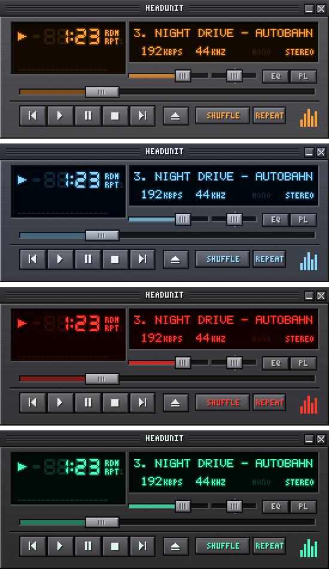

# Headunit

A local-file desktop music player in the Winamp 2.x form factor, lit like a
1990s car head unit — every colour in the chrome is a theme token, so the same
pixel-exact UI can be amber Blaupunkt, ice-blue Alpine, Pioneer red, or VFD
green.

**Status: M2 — skin engine.** The main window is fully drawn and works by
mouse: transport, seek, volume, balance, a seven-segment clock with ghost
segments, a scrolling dot-matrix title, and kbps / kHz / stereo readouts. Press
**T** to re-light it in another colourway.



*Rendered by `tools/Headunit.SkinPreview` — the same code path the app draws
with, so this is exactly what you see on screen at 2x.*

- **Windows first** — .NET 8 + WPF + NAudio, fully native, Windows 10 1809+.
- **macOS after** — Swift + AppKit + AVAudioEngine, same visual style, some
  deliberately different features.
- **v1 scope** — local files, 10-band EQ with presets, spectrum visualiser,
  media keys + tray, and the theme customiser.

👉 **[Read the full plan in `docs/PLAN.md`](docs/PLAN.md)**

## Layout

| Project | Target | What it is |
|---|---|---|
| `src/Headunit.Core` | `net8.0` | Playback, themes, and the whole pixel pipeline — atlas, tinting, fonts, layout, hit-testing, frame rendering. No Windows dependencies, so it is testable anywhere. |
| `src/Headunit.Audio.Windows` | `net8.0-windows10.0.17763.0` | WASAPI output via NAudio, behind `IAudioEngine`. |
| `src/Headunit.Skin` | `net8.0-windows10.0.17763.0` | Presents a rendered frame in WPF and forwards the pointer; the integer-scaling host. |
| `src/Headunit.Player.Windows` | `net8.0-windows10.0.17763.0` | The WPF shell. Builds `Headunit.exe`. |
| `tests/Headunit.Core.Tests` | `net8.0` | xUnit tests for the engine and the skin. |
| `tools/Headunit.SkinPreview` | `net8.0` | Renders the main window to PNG in every theme — review the art on any OS. |

## Building

```bash
dotnet build Headunit.sln
dotnet test  tests/Headunit.Core.Tests/Headunit.Core.Tests.csproj
```

On Linux and macOS the Windows projects still **compile** (the build sets
`EnableWindowsTargeting` for you) so you get real feedback on non-Windows
machines — but only Windows can run the app. You can still *see* it anywhere:

```bash
dotnet run --project tools/Headunit.SkinPreview -- skin-preview 3
```

writes the main window in every theme, a few interaction states, and the raw
atlas mask to `skin-preview/` at 3x. CI uploads the same set as a build artifact.

## Running

```bash
dotnet run --project src/Headunit.Player.Windows
```

Drop audio files or a folder onto the window to load a queue (hold **Shift**
to append instead of replace), or press the eject button to pick files.

| Mouse | Does |
|---|---|
| Transport buttons | Act on release — slide off before letting go to cancel, like a real button |
| Seek bar | Drag to scrub; the LCD previews the target and it jumps on release |
| Volume / balance | Live while dragging, with a readout on the LCD; balance snaps to centre |
| Clock | Toggle elapsed / remaining |
| Wheel anywhere | Volume |
| Title bar | Drag to move the window |

| Key | Does |
|---|---|
| `Z` `X` `C` `V` `B` | Previous, play, pause, stop, next — Winamp's own layout |
| `L` | Open files (same as eject) |
| `Space` | Play / pause |
| `←` `→` | Seek 5 seconds |
| `↑` `↓` | Volume |
| `S` / `R` | Shuffle / cycle repeat off → all → one |
| `T` | Next colourway |
| `Ctrl+1` … `Ctrl+4` | Zoom 1x to 4x |

The EQ and PL buttons are drawn but their windows arrive in M3 and M4; until
then they say so on the LCD.

---

All artwork is drawn from scratch. This project bundles no Winamp assets and is
not affiliated with Winamp.
